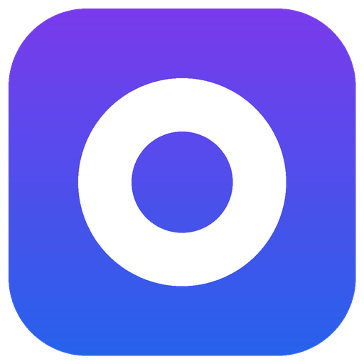

> [!CAUTION]
> The only official places to download OguTool Strap are this GitHub repository
> and <https://ogutool.github.io/ogutool-strap>. Don't download it anywhere else.

<div align="center">



# OguTool Strap

**A Roblox bootstrapper with one-click fast flag presets.**

![][badge-license]
![][badge-actions]
![][badge-downloads]
[![][badge-latest]][repo-latest]
![][badge-stars]

[**⬇ Download the latest release**][repo-latest] · [Website][site] · [Report a bug][repo-new-issue]

</div>

OguTool Strap is a custom bootstrapper for Roblox based on [Fishstrap][fishstrap]
and [Bloxstrap][bloxstrap]. It launches Roblox for you and adds extra settings,
including a fast flag page with ready-made presets you can apply in one click.

> [!NOTE]
> OguTool Strap runs on **Windows 10 and above** and needs the
> [.NET 6 Desktop Runtime][dotnet6].

## Features

- **One-click fast flag presets**
  - **Best FPS**: uncapped FPS, no shadows, grass, wind or post effects
  - **Best Graphics**: high textures, 4x anti-aliasing, better lighting
  - **Potato PC**: the lowest settings for weak laptops
  - **Essentials**: FPS unlock and no ads or telemetry, graphics unchanged
  - **Clear all**: removes every flag
- Full fast flag editor (import and export JSON)
  - Roblox only applies flags on its allowlist. [Learn more][devforum-fflags]
- Global Basic Settings editor (frame rate cap, quality level and more)
- Detailed server information, Discord Rich Presence and game history
- Roblox Studio support, cache cleaner, channel switcher and more

## Install

1. Download `OguToolStrap.exe` from the [latest release][repo-latest].
2. Run it. If Windows shows "Windows protected your PC", click
   **More info → Run anyway** (the app isn't code-signed).
3. Follow the installer. It installs to `%LocalAppData%\OguToolStrap`.
4. Open **OguTool Strap → Fast Flags** and click a preset, then press **Save**.

## Build it yourself

You need the [.NET 6 SDK][dotnet6] and Git.

```bash
git clone --recurse-submodules https://github.com/Ogutool/ogutool-strap.git
```

```bash
cd ogutool-strap
```

```bash
dotnet publish -p:PublishSingleFile=true -r win-x64 -c Release --self-contained false ./Bloxstrap/Bloxstrap.csproj
```

The exe ends up in `Bloxstrap/bin/Release/net6.0-windows/win-x64/publish/`.

### Adding your own preset

Presets live in [`Bloxstrap/OguPresets.cs`](Bloxstrap/OguPresets.cs). Add an
entry to `All`, then add a button with the same `Tag` in
[`FastFlagsPage.xaml`](Bloxstrap/UI/Elements/Settings/Pages/FastFlagsPage.xaml).

## Credits and licenses

OguTool Strap is released under the [MIT License](LICENSE).

It is built on top of these projects, whose licenses are kept in this repo:

- [Fishstrap][fishstrap] by returnrqt: [LICENSE.Fishstrap](LICENSE.Fishstrap)
- [Bloxstrap][bloxstrap] by pizzaboxer: [LICENSE.Bloxstrap](LICENSE.Bloxstrap)
- [WPF UI](https://github.com/lepoco/wpfui) and other libraries: see [NOTICE.md](NOTICE.md)

OguTool Strap is not affiliated with Roblox Corporation, Fishstrap or Bloxstrap.

[site]: https://ogutool.github.io/ogutool-strap
[fishstrap]: https://github.com/returnrqt/fishstrap
[bloxstrap]: https://github.com/bloxstraplabs/bloxstrap
[dotnet6]: https://dotnet.microsoft.com/download/dotnet/6.0
[devforum-fflags]: https://devforum.roblox.com/t/allowlist-for-local-client-configuration-via-fast-flags/3966569

[badge-license]:   https://img.shields.io/github/license/Ogutool/ogutool-strap
[badge-actions]:   https://img.shields.io/github/actions/workflow/status/Ogutool/ogutool-strap/ci-release.yml?branch=main&label=build
[badge-downloads]: https://img.shields.io/github/downloads/Ogutool/ogutool-strap/total
[badge-latest]:    https://img.shields.io/github/v/release/Ogutool/ogutool-strap?color=7c3aed
[badge-stars]:     https://img.shields.io/github/stars/Ogutool/ogutool-strap

[repo-latest]:    https://github.com/Ogutool/ogutool-strap/releases/latest
[repo-new-issue]: https://github.com/Ogutool/ogutool-strap/issues/new/choose
